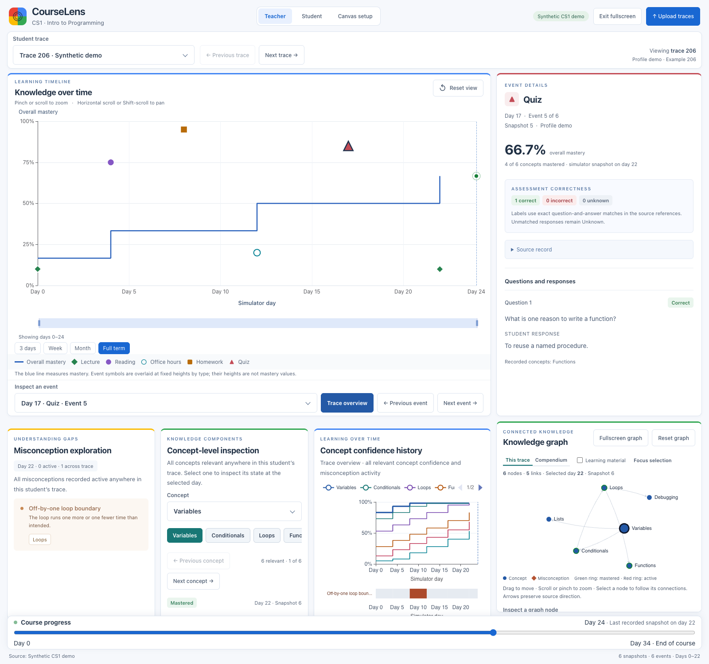
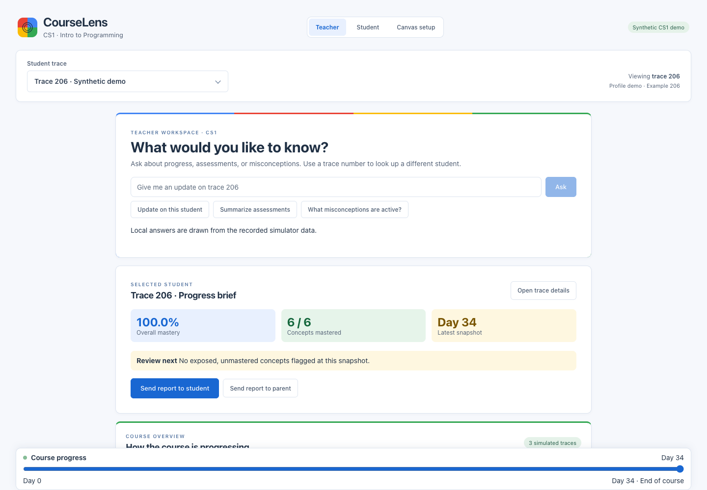
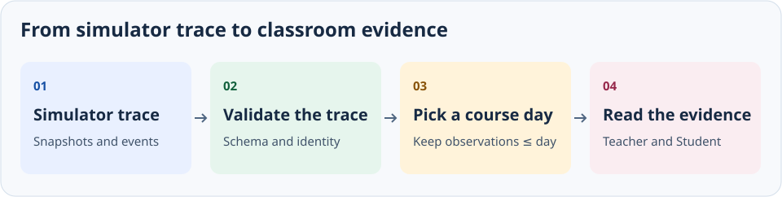

# CourseLens

CourseLens turns simulated CS1 learning traces into a teacher workspace. Ask about a student’s progress, then open the timeline and inspect the event behind the answer.



*Trace 206 at day 24 of 34, about 71% through the course. The event panel shows the day 17 quiz and its recorded answer.*

## Try it

Requires Node.js 22.12+ and pnpm 11.25.

```sh
pnpm install --frozen-lockfile
pnpm dev
```

Open the URL Vite prints. The demo includes three synthetic traces and starts on trace 206 at day 34.

1. In **Teacher**, click **What misconceptions are active?**, then **Open trace 206 details**.
2. Move **Course progress** to day 8. Inspect the homework event in **Progress & evidence**.
3. Switch to **Student**. The day stays at 8.

[Watch the walkthrough](docs/media/walkthrough.mp4)

To reproduce the screenshot, open **Trace details**, move **Course progress** to day 24, click **Fullscreen view**, and choose the day 17 quiz under **Inspect an event**.



## How it works



The teacher workspace answers progress, assessment, and misconception questions with local query handlers. Trace details show the timeline and event evidence. The course overview summarizes recorded activity across traces.

Reports, contacts, and notes stay in the current browser. Canvas setup uses a sample course map; the demo needs no account, API key, or real student records.

## Development

```sh
pnpm test
pnpm build
```

Built with React, TypeScript, Vite, Zod, and ECharts. See [local research data setup](docs/research-data.md) for authorized exports.
